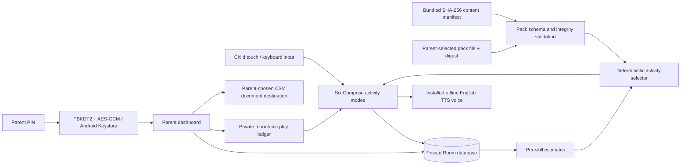

# Architecture and data flow

The offline APK has no INTERNET, RECORD_AUDIO, contacts or location permission. No advertising, analytics, Google Play services or child-facing external link is integrated. Android minSdk 26 is a deliberate first-build compatibility floor; older Fire OS devices may be excluded. Orientation is not locked.

No child data leaves the app automatically. An exported CSV can leave the device through the destination a parent chooses; that copy is outside app erasure. Optional pack content comes through the Android document picker. Signed envelopes are capped at 7 MB and decoded payloads at 5 MB. The app verifies a pinned P-256 publisher key, SHA-256, schema, ID namespace and increasing version before atomic replacement. A durable version high-water mark survives optional-pack removal. Unsigned JSON imports are development-only. See `CONTENT-DELIVERY.md`; there is no network catalogue.

Room owns profiles, attempts, assignments and unique mission-completion events. A challenge's first submission is idempotent by session/step/activity ID, so repeated practice in a small pack still records separate challenges. Later answer retries do not rewrite first-try evidence. Completing a mission writes its run ID and increments the assignment in one transaction; retrying that run cannot count twice. Sessions are stored separately in private preferences so interrupted missions can resume. Profile deletion removes attempts, assignments, completion events, session records and play accounting. Transactional writes discard late attempts/assignments for a deleted profile. Room version 2 migrates existing records and adds volume/decoration defaults without destructive recreation. Android backups are disabled; there is no cross-device sync or automatic recovery.

The selector filters by game, selected year, recent activity IDs and optional assignment skill/difficulty. It prefers the target difficulty and less-practised skills. Three independent correct answers can increase difficulty; repeated errors reduce it. Missing prerequisite mastery keeps practice at the easiest level. Skill estimates use the last ten first submissions; hints prevent an answer from counting as independent evidence. Timing does not determine mastery. The starter pack still needs meaningful prerequisite graph authoring and higher-year depth.

The play ledger charges foreground child-area use, including browsing the arcade. Parent use, pause screens and background time do not count. Each tick is committed, limiting restart leakage to approximately one second. Backwards calendar changes do not refresh an allowance; a rooted device or deliberate forward date manipulation needs additional controls. Bedtime uses local wall-clock hours. A parent bonus extends the daily allowance and does not bypass bedtime. Breaks are suggestions, not a medical recommendation.

The release build must use approved-only content, no development access entitlement, configured verified Amazon billing, a production signing identity, and reviewed language resources. Current unreviewed packs deliberately prevent a release-readiness check from passing.
